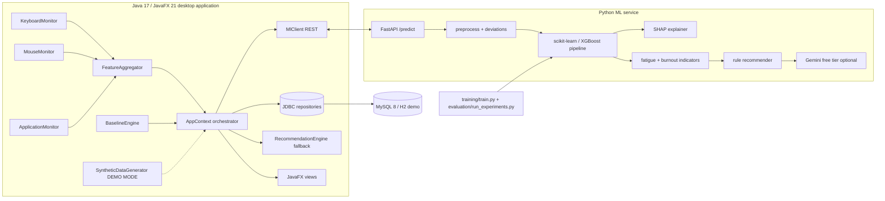

# 1. System architecture

## 1.1 Data flow
```
USER ──► KEYBOARD MONITOR (JNativeHook: press/release timestamps, correction-key flag)
     ──► MOUSE MONITOR    (JNativeHook: x, y, t, click count)
     ──► APPLICATION MONITOR (JNA/xdotool/osascript: foreground process name → CATEGORY, name discarded)
                    │
                    ▼   every 60 s (configurable)
            FEATURE AGGREGATOR  (java-app/feature/FeatureAggregator)  → FeatureWindow (26 absolute features)
                    │
                    ▼
            MySQL behavior_features  (prepared statements, HikariCP)
                    │
                    ▼
            PERSONAL BASELINE ENGINE (java-app/baseline/BaselineEngine) → 18 deviation features (dev_*, z_*)
                    │
                    ▼   HTTP POST /predict (JSON: absolute features + baseline stats + recent-session history)
            PYTHON ML SERVICE (ml/api/server.py, FastAPI)
              ├─ preprocessing: one-hot app category, deviation features (identical formulas)
              ├─ StandardScaler + best model (chosen by Experiment 1, e.g. XGBoost / RandomForest)
              ├─ stress probabilities → class + stress score (expected value)
              ├─ fatigue indicator (transparent composite) & burnout-risk indicator (session trend)
              ├─ SHAP TreeExplainer → top factors in human-readable form
              └─ rule-based recommendations (+ optional Gemini free-tier re-phrasing, aggregates only)
                    │
                    ▼
            MySQL predictions / recommendations
                    │
                    ▼
            JAVAFX DASHBOARD  (Dashboard · Behaviour · History · Explanation · Reports · Settings)
```

## 1.2 Component diagram


## 1.3 Why REST integration (Java ↔ ML)
| Option | Verdict |
|---|---|
| **FastAPI REST (chosen)** | SHAP, baseline profiles, indicators and recommender stay in Python where the libraries exist; JSON contract is explicit; localhost latency ≈ 5 ms; easy to demo and to swap models. |
| ONNX | Exports only the classifier; XGBoost/SHAP explanations would need re-implementation in Java. |
| PMML | Limited model coverage, same explainability gap. |
| Java-native ML (Weka/Smile) | Would break the "compare 6 models + SHAP" requirement and the shared preprocessing code. |

## 1.4 Technology stack (all free)
Java 17 LTS · JavaFX 21 · Maven · JNativeHook 2.2 · JNA 5.14 · MySQL 8 Community (H2 embedded for demo) · HikariCP · Gson ·
Python 3.10+ · pandas · NumPy · scikit-learn · XGBoost · SHAP · matplotlib · FastAPI · uvicorn · pytest · JUnit 5 ·
Gemini API free tier (optional).

## 1.5 Feature definitions
| Feature | Definition (per 60-s window) |
|---|---|
| typing_speed_wpm | keystrokes ÷ 5 ÷ minutes (5-character word convention) |
| keystrokes_per_min | key presses per minute |
| avg_key_hold_ms | mean press→release duration |
| avg_key_latency_ms | mean press→press interval (< 1.5 s) |
| backspace_rate | (Backspace+Delete presses) ÷ key presses |
| error_rate | correction-based proxy for typing errors (no text is stored, so true error rate is unobservable) |
| pause_count / avg_pause_ms | number and mean length of inter-key gaps ≥ 1.5 s |
| burst_count | runs of ≥ 5 keys with gaps ≤ 250 ms |
| typing_rhythm_cv | coefficient of variation of inter-key latency |
| mouse_distance_px / mouse_speed_px_s / mouse_accel_px_s2 | path length, mean speed, mean |Δspeed|/Δt |
| click_count / click_rate / double_click_rate | clicks, clicks per minute, double clicks per minute |
| avg_click_distance_px | mean distance between consecutive clicks |
| mouse_idle_s | seconds without cursor motion |
| direction_changes | heading changes > 90° |
| mouse_speed_cv | coefficient of variation of speed (irregularity) |
| app_switch_count / app_switch_rate | foreground-app changes, per minute |
| active_app_category | dominant category (IDE, BROWSER, DOCUMENT, COMMUNICATION, ENTERTAINMENT, OTHER) |
| time_in_app_s | mean dwell time per app in the window |
| work_duration_s / idle_duration_s | activity-weighted split of the window |
| continuous_work_s | seconds since the last idle break (≥ idle threshold) |
| dev_X | (X − baseline mean) ÷ |baseline mean| for 9 baseline features |
| z_X | (X − baseline mean) ÷ baseline std, capped ±10 |
